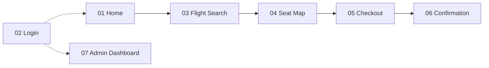
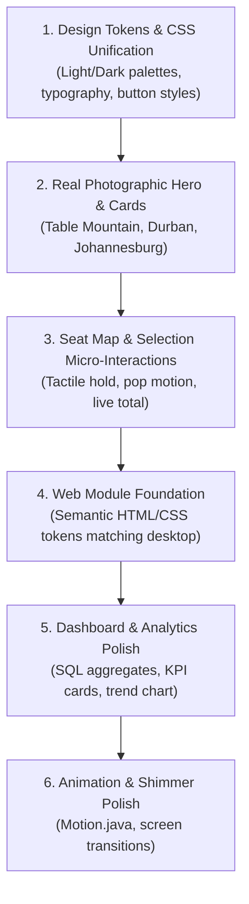

# Elevate Design Specification: Desktop & Web Design System

<!-- ===================================================================== -->
<!-- BRAND CONFIGURATION: DEFINE PRODUCT NAME IN EXACTLY ONE PLACE        -->
<!-- ===================================================================== -->
<!-- APP_NAME = "SkyVoyage"                                               -->
<!-- ===================================================================== -->

> **System Notice**: This specification defines the unified design language, design tokens, component anatomy, motion principles, and implementation feasibility plans for **SkyVoyage** (`APP_NAME`) across the JavaFX desktop application and the responsive web portal.

---

## 1. Observations from Inspiration Artifacts

Each inspiration artifact (`design-v2/inspiration/*.jpg`) was analyzed across layout, spacing, typography, depth, color harmony, and motion cues to extract concrete techniques for elevating SkyVoyage without copying logos, brands, liveries, or illustrations.

### 1. `D10_sidebar_stats_bookings_list.jpg` (Light Operations Dashboard)
- **Layout & Structure**: Clear three-column division (compact utility sidebar, analytical workspace, active schedule drawer) with consistent 24px inner margins, preventing cognitive overload while maintaining information density.
- **Metric Prominence & Depth**: High typographic hierarchy pairing giant bold metric values (`840`, `235`, `$2M`) with miniature upward-trend badge pills (`+1.5`, `+0.2`) and multi-layer elevation (soft 16px blur drop-shadows on clean white cards).
- **Subtle Surface Tinting**: Functional status color coding across card headers (royal blue, soft lavender, midnight navy) grounding each card category without clashing with the neutral canvas.

### 2. `D11_topdown_cabin_seatmap_livestatus.jpg` (Executive Cabin & Live Status)
- **Top-Down Orthographic Fuselage**: Clean architectural top-down aircraft outline with subtle fuselage contouring and distinct bay divisions (flight deck, galleys, First Class, Economy) that immediately establishes context.
- **Seat State Differentiation**: Tactile seat representations with clear affordances—available seats rendered with clean 1px borders, booked seats styled with subtle textural muted fills, and active selections accented with solid contrast and localized glow.
- **Segmented Donut Analytics**: Multi-texture circular donut status indicator combining solid, diagonal-hatch, and dotted arc segments to represent live operational capacity without relying solely on color hue.

### 3. `D7_dark_dashboard_seatpanel_checkout_pill.jpg` (Dark Cockpit Theme & Route Badges)
- **Atmospheric Midnight Palette**: Deep petrol and midnight background (`#0B131A` / `#0D1921`) accented with subtle emerald backlighting that creates a calm, focused executive feel without causing eye fatigue.
- **Unified Action-Price Pill**: The checkout button is designed as a segmented pill component (`[ Checkout | $900.00 >> ]`), combining route confirmation, total price, and call-to-action into a single tactile anchor.
- **Prominent Route Anchors**: Oversized bold IATA codes (`JFK ⇄ MXP`) with a central directional arrow and subtle distance tracker line, giving the user immediate geographical reassurance.

### 4. `D8_dark_operations_stats_area_chart.jpg` (Dark Analytics & Glowing Area Spline)
- **Luminescent Spline Chart**: High-end data visualization featuring a smooth cubic bezier spline curve with an upward-gradient translucent fill beneath, accented by floating interactive data pill pins (`10,200`).
- **Stat Cards with Integrated Trend Chips**: Top-aligned circular icon discs, large high-contrast numerical metrics (`1,284`, `$184.6K`), and top-right pill-shaped change chips (`+12.8%`, `+7.9%`) indicating positive velocity.
- **Clean Ranked Bar Metrics**: Horizontal progress tracks with dual-dot connectors and tabular monospace values for top destinations, maintaining alignment regardless of string lengths.

### 5. `D9_sidebar_dashboard_map_donut.jpg` (Curved Shell & Calm Tonal Harmony)
- **Floating Tablet Container Shell**: Elegant rounded window boundary (24px corner radius) with an integrated vertical pill navigation rail that feels lightweight and modern.
- **Calm Daylight Palette**: Soft periwinkle and slate accents on a warm off-white canvas (`#F7F9FC`), avoiding clinical starkness while retaining high readability.
- **Harmonious Card Cadence**: Strict horizontal grid lines ensuring that weather pills, bar chart containers, and donut meters align seamlessly along shared baselines.

### 6. `W1_mono_plane_hero_pill_tabs.jpg` (Monochrome Luxury & Floating Search Form)
- **Restrained Monochromatic Foundation**: Restrained grayscale and slate palette with high negative space, creating an authoritative luxury aesthetic where photographic or brand accents pop effortlessly.
- **Floating Pill Switcher**: Floating pill tabs (`[ Flights ] [ Hotels ] [ Cars ]`) with a sliding dark capsule indicator providing tangible tactile state feedback.
- **Segmented Modular Search Cells**: Search card designed as connected contiguous cells separated by subtle 1px dividers, treating origin, destination, dates, and passengers as one unified instrument panel.

### 7. `W2_centered_plane_tabbed_search.jpg` (Symmetrical Editorial Framing)
- **Editorial Typography Scale**: Dramatic scale contrast between light editorial headlines ("Explore the World in Style.") and structured, compact form labels below.
- **Centered Reflection Grounding**: Aircraft silhouette grounded with a soft surface reflection and subtle gradient backdrop, creating depth without requiring complex 3D scenes.
- **Intentional Accent Economy**: A single, disciplined call-to-action accent color applied exclusively to primary interactive triggers (`Book a Flight`, `Continue`), preventing visual friction.

### 8. `W3_photo_hero_frosted_search.jpg` (Glassmorphism & Cloudscape Hero)
- **Frosted Glassmorphism Layer**: Translucent search card with soft blur and a crisp 1px light specular highlight border floating over high-altitude cloudscape photography.
- **Overhanging Category Tabs**: Pill tabs positioned half-over the top card border, breaking up rigid rectangular geometry and guiding the eye down to the search fields.
- **Two-Line Date Cell Structure**: Date input cells displaying large bold numerical days alongside stacked smaller month and weekday text (`16 Jan, 26 | Friday`), accelerating recognition.

### 9. `W5_sections_cards_pastel.jpg` (Editorial Content Cadence)
- **Spacious Section Breathing Room**: Generous vertical padding (80px to 100px) between landing page sections, creating a calm, leisurely reading pace reminiscent of high-end travel journals.
- **Destination Card Visual Anchors**: 16px rounded photo cards featuring subtle hover zoom, micro pill badges, and circular arrow action buttons (`↗`).
- **High-Impact Condensed Type**: Heavy grotesque sans-serif section headings with tight tracking that command instant visual hierarchy without requiring decorative icons.

### 10. `W6_cloud_hero_destination_photo_cards.jpg` (Destination Photo Grid & Trust Bar)
- **Consistent Aspect Ratio Photo Grid**: Uniform 4:3 destination photo cards with bottom gradient vignettes ensuring white text remains 100% legible over varying photo backgrounds.
- **Pinned Top-Left Category Pills**: Floating frosted pill chips (`✈ Flights`) pinned consistently to the top-left corner of cards, establishing brand consistency across content types.
- **Horizontal Trust & Scale Metrics**: Understated horizontal metrics bar (`50,000+`, `4.9/5`, `1,200+`) utilizing light gray vertical hairpins to divide statistics cleanly.

### 11. `X4_interior_floorplan_viewer.jpg` (Architectural Precision & Longitudinal Flow)
- **Technical Floorplan Schematics**: Architectural layout showing cabin zones (Cockpit, Galleys, First Class, Economy) with clean line art seats and clear circulation aisles.
- **Longitudinal Section Navigation**: Numbered circular stepper capsules (`1`, `2`, `3`, `4`) linked to forward/backward chevrons, enabling intuitive inspection of large aircraft layouts.
- **Aerospace Industrial Aesthetic**: Clean technical greys, hairline borders, and precise dimensional spacing evoking high-performance aeronautical engineering.

---

## 2. Our Direction: The SkyVoyage Design Brief

### Brand & Product Identity
- **Central Product Name**: Defined once as `APP_NAME = "SkyVoyage"`.
- **Mood**: *Quiet Executive Luxury & Authentic African Warmth*. Inspired by golden hour over Table Mountain and high-altitude sunset departures, combining the serene confidence of private aviation with genuine hospitality.
- **Three Core Adjectives**:
  1. **Composed**: Unhurried, deliberate white space, quiet confidence; interfaces never shout or crowd the user.
  2. **Tactile**: Crisp 1px hairline borders, soft layered drop-shadows, subtle physical spring/scale feedback on press, and tangible card elevation.
  3. **Human**: Clear passenger-centered copy, authentic South African landscape photography, empathetic error messages with immediate paths forward, and zero artificial intelligence or corporate buzzwords.

### What to Avoid
- **No generic marketing clichés**: Strictly forbidden words: *"seamless"*, *"cutting-edge"*, *"unlock the power"*, *"elevate your journey"*, *"revolutionary"*, *"world-class"*, *"in today's fast-paced world"*.
- **No emojis as UI icons**: Use clean geometric SVG paths only.
- **No exclamation marks in error dialogues**: Errors state calmly what occurred and provide an exact recovery action.
- **No 3D engine dependencies**: No heavy WebGL or JavaFX 3D meshes that cause frame drops; rely on high-fidelity orthographic SVG paths, real photographic textures, and hardware-accelerated 2D transforms.
- **No decorative clutter**: Every element, border, and badge must serve an informative purpose.

### Palette Rationale: Why Keep Deep Navy and Warm Gold
The **Deep Navy** (`#0D1B2A` / `#0A1118`) and **Warm Gold** (`#D4AF37` / `#C5A028`) palette is retained and refined because:
1. **Psychological Trust & Heritage**: Deep navy is the universal international standard of maritime and aeronautical authority, stability, and calm nighttime skies.
2. **Warmth of South African Light**: Warm gold evokes the distinct golden hour sunlight across the Highveld and Cape Peninsula, lifting navy out of cold corporate neutrality into hospitable luxury.
3. **Contrast & Hierarchy**: Gold serves as an unmistakable, high-contrast primary action cue across both light and dark themes, ensuring critical CTAs (Search Flights, Select Seat, Confirm Booking) are immediately recognized.

---

## 3. Design Tokens

### 3.1 Color Tokens

#### Light Theme
| Token Name | Hex / RGBA | Usage |
|---|---|---|
| `-sv-canvas` | `#F4F6F9` | Page and window background |
| `-sv-surface` | `#FFFFFF` | Primary cards, modal backgrounds, input backgrounds |
| `-sv-surface-elevated` | `#F8FAFC` | Secondary card headers, nested containers, table zebra rows |
| `-sv-surface-frosted` | `rgba(255, 255, 255, 0.82)` | Search cards, navigation bars, floating summary pills |
| `-sv-border` | `#E2E8F0` | Default 1px card borders, table row dividers |
| `-sv-border-subtle` | `rgba(13, 27, 42, 0.08)` | Inner container dividers, input borders |
| `-sv-text-primary` | `#0D1B2A` | Primary headlines, flight numbers, key metrics |
| `-sv-text-secondary` | `#475569` | Body paragraphs, step subtitles, route text |
| `-sv-text-muted` | `#94A3B8` | Input placeholders, inactive nav links, timestamps |
| `-sv-gold-primary` | `#C5A028` | Primary CTA buttons, active accents, selected seat border |
| `-sv-gold-hover` | `#B38F1E` | Hover state for primary buttons |
| `-sv-gold-surface` | `#FFFDF5` | Selected seat background, highlight card tint |
| `-sv-navy-deep` | `#0D1B2A` | Table headers, primary brand marks, dark contrast chips |
| `-sv-navy-surface` | `#1E293B` | Dark badge pills, dark popover backgrounds |
| `-sv-green-status` | `#16A34A` | Available seats, confirmed booking checkmark, success badge |
| `-sv-green-bg` | `#DCFCE7` | Available seat fill, positive metric badge background |
| `-sv-red-status` | `#DC2626` | Booked/taken seats, validation error message, cancellation chip |
| `-sv-red-bg` | `#FEE2E2` | Booked seat fill, error banner background |

#### Dark Theme
| Token Name | Hex / RGBA | Usage |
|---|---|---|
| `-sv-canvas` | `#070D14` | Deep window canvas, dark backdrop |
| `-sv-surface` | `#0D1B2A` | Primary cards, content panels, nav bar background |
| `-sv-surface-elevated` | `#142538` | Table headers, elevated cards, hovering rows |
| `-sv-surface-frosted` | `rgba(13, 27, 42, 0.86)` | Frosted glass search overlay, floating action pills |
| `-sv-border` | `#1E354F` | Card outlines, row dividers, subtle keylines |
| `-sv-border-subtle` | `rgba(255, 255, 255, 0.10)` | Inner separators, input border resting state |
| `-sv-text-primary` | `#F8FAFC` | Primary headlines, flight numbers, active values |
| `-sv-text-secondary` | `#94A3B8` | Body text, route descriptions, labels |
| `-sv-text-muted` | `#64748B` | Disabled indicators, placeholder text, secondary captions |
| `-sv-gold-primary` | `#D4AF37` | Primary action buttons, selection indicators, accent lines |
| `-sv-gold-hover` | `#E2C04D` | Hover state for gold buttons in dark mode |
| `-sv-gold-surface` | `rgba(212, 175, 55, 0.15)`| Selected seat glow, gold badge background |
| `-sv-navy-deep` | `#09121D` | Canvas recess, recessed inputs |
| `-sv-navy-surface` | `#172A3E` | Chip backgrounds, active stepper capsule background |
| `-sv-green-status` | `#22C55E` | Available seat indicators, confirmed checkmarks |
| `-sv-green-bg` | `rgba(34, 197, 94, 0.18)` | Available seat background pill |
| `-sv-red-status` | `#EF4444` | Booked seat badges, validation alerts |
| `-sv-red-bg` | `rgba(239, 68, 68, 0.18)` | Booked seat background |

### 3.2 Typography Tokens
Strict limit of **three distinct type sizes per screen** to guarantee clean visual hierarchy.

| Level | Size | Weight | Line Height | Usage |
|---|---|---|---|---|
| `display` | 28px | 700 Bold | 34px | Hero headline, Booking Confirmation reference code |
| `h1` | 22px | 600 Semi-Bold | 28px | Screen title, Admin KPI numbers, Route headers |
| `h2` | 18px | 600 Semi-Bold | 24px | Card headers, Cabin section titles (`FIRST CLASS 2x2`) |
| `body` | 14px | 400 Regular | 20px | Table cell text, form labels, passenger inputs |
| `caption` | 12px | 500 Medium | 16px | Timestamps, aircraft model, IATA subtitle, table headers |
| `pill` | 11px | 700 Bold | 14px | Status chips, change badges (`+12.8%`), class tags |

### 3.3 Spacing Scale
Based on an 8-point geometric scale with a 4px half-step for micro-alignment:
`4px` (xxs), `8px` (xs), `12px` (sm), `16px` (md), `24px` (lg), `32px` (xl), `48px` (2xl), `64px` (3xl).

### 3.4 Corner Radii
- `4px`: Micro tags, small status dots, table cell tags.
- `8px`: Text fields, combo boxes, primary buttons, table rows.
- `12px`: Content cards, search cards, flight result cards, checkout summary boxes.
- `16px`: Hero search overlay, modal windows, dialog containers.
- `999px`: Stepper circles, status pills, filter tabs, circular icon buttons.

### 3.5 Elevation & Drop Shadows
- **Elevation 1 (Resting Cards & Table Rows)**:
  `drop-shadow(gaussian, rgba(0, 0, 0, 0.05), 8, 0, 0, 2)`
- **Elevation 2 (Floating Search Card, Hover Rows, Dropdown Menus)**:
  `drop-shadow(gaussian, rgba(0, 0, 0, 0.12), 16, 0, 0, 6)`
- **Elevation 3 (Modal Dialogs, Boarding Pass PDF Preview Popover)**:
  `drop-shadow(gaussian, rgba(0, 0, 0, 0.22), 28, 0, 0, 10)`

### 3.6 Frosted Glass & Surface Rules
- **Web**: `backdrop-filter: blur(14px); -webkit-backdrop-filter: blur(14px); background: rgba(255, 255, 255, 0.80); border: 1px solid rgba(255, 255, 255, 0.35);` (Light) / `background: rgba(13, 27, 42, 0.85); border: 1px solid rgba(255, 255, 255, 0.12);` (Dark).
- **JavaFX**: Since JavaFX 21 CSS lacks native live backdrop filter shaders, frosted cards are implemented with:
  1. Semi-transparent surface fill (`rgba(255, 255, 255, 0.88)` in light, `rgba(13, 27, 42, 0.90)` in dark).
  2. Double border highlight: Outer border `1px solid -sv-border`, inner border inset `1px solid rgba(255, 255, 255, 0.15)`.
  3. Pre-blurred background image layer when placed over rich photographic hero scenes.

### 3.7 Photo Overlay Rules
- **Golden Hour Alignment**: All imagery utilizes warm, natural South African daylight (Table Mountain, Durban Golden Mile, Nelson Mandela Bridge, Ponte Tower).
- **Gradient Overlay Standard**: Overlays ensure strict WCAG AA contrast (minimum 4.5:1 for normal text, 3:1 for large display titles):
  `linear-gradient(to right, rgba(10, 17, 24, 0.88) 0%, rgba(10, 17, 24, 0.55) 55%, rgba(10, 17, 24, 0.15) 100%)`.
- **Standardized Aspect Ratios**:
  - Hero banner: `16:9`
  - Destination card: `4:3`
  - Login split panel: `3:4`

---

## 4. Component Library: Specifications, ASCII Sketches & States

### 1. Navigation Bar (`nav`)
```
+-----------------------------------------------------------------------------------------------+
| [✈ SkyVoyage]     Flights    My Bookings    About    Contact          [ ☀ Dark ]   [ Log In ] |
+-----------------------------------------------------------------------------------------------+
```
- **Default**: Transparent or frosted surface (`-sv-surface-frosted`), brand mark with gold plane SVG, navigation links in `-sv-text-secondary`.
- **Hover**: Link text turns `-sv-gold-primary` with a 2px subtle bottom indicator dot; theme switcher scales slightly (`1.05`).
- **Active / Selected**: Nav link text bolded with solid gold bottom capsule pill indicator.
- **Admin Mode**: Displays gold pill badge `[ ADMIN PORTAL ]` beside user name with direct route to Dashboard.

### 2. Search Card (`search-card`)
```
+-------------------------------------------------------------------------------------------------+
|  [ ✈ Flights ]   [ 🏨 Hotels (Soon) ]                                                           |
| +-------------------------+-------------------------+--------------------+--------------------+ |
| | FROM                    | TO                      | DEPARTURE          | PASSENGERS         | |
| | Johannesburg (JNB)  [⇄] | Cape Town (CPT)         | 2 Nov 2026         | 1 Adult            | |
| +-------------------------+-------------------------+--------------------+--------------------+ |
|                                                                     [ 🔍 Search Flights      ] |
+-------------------------------------------------------------------------------------------------+
```
- **Default**: Elevated card (16px radius, Elevation 2), segmented cell grid separated by hairline dividers (`-sv-border`).
- **Hover**: Input cell border deepens to `-sv-gold-primary` with 120ms transition. Swap icon button `[⇄]` rotates 180° on click.
- **Active / Focused**: Active cell gains subtle gold outer ring (`0 0 0 2px rgba(212, 175, 55, 0.25)`).
- **Disabled**: Search button shows opacity 0.5 when required origins or dates are unselected.

### 3. Flight Result Row (`flight-result-row`)
```
+-------------------------------------------------------------------------------------------------+
| GRP 204      06:30 ------------ 2h 10m ------------> 08:40      Non-stop        From            |
| Boeing 737   JNB                                     CPT                        R 1,200 [Select]|
+-------------------------------------------------------------------------------------------------+
```
- **Default**: 72px fixed height card with 8px radius, white background (light) or navy background (dark), hairline border.
- **Hover**: Row elevates with `-sv-border` turning gold, subtle translation (`-1px` Y), and shadow transitioning to Elevation 2.
- **Active / Pressed**: Select button scales to `0.98` on click before loading the Seat Map.
- **Empty / No Results**: Card collapses into a friendly empty-state card with a warm message and a button to adjust dates.

### 4. Top-Down Cabin Seat Map (`seat-map`)
```
                                /       \
                               | Cockpit |
                                \_______/
                     [--- FIRST CLASS (2 x 2) ---]
                Row 1   [1A] [1B]   | Aisle |   [1C] [1D]
                Row 2   [2A] [2B]   | Aisle |   [2C] [2D]
                
                      [--- ECONOMY (3 x 3) ---]
                Row 6   [6A] [6B] [6C]  |  [6D] [6E] [6F]
                Row 7   [7A] [7B] [7C]  |  [7D] [7E] [7F]
                Row 8   [8A] [8B] [8C]  |  [8D] [8E] [8F]
                ...
                (•) Available [Green]   (✓) Selected [Gold]   (✕) Taken [Muted Red]
```
- **Available State**: Clean rounded rectangle, green outline (`#16A34A`), soft green tint fill on hover with tooltip showing class and price.
- **Selected State**: Solid gold fill (`-sv-gold-primary`), white bold label, subtle gold drop glow, momentary scale pop (`1.0 -> 1.12 -> 1.0`).
- **Booked / Taken State**: Muted slate/red background, low-contrast text, disabled cursor (`Cursor.DEFAULT`), unclickable.
- **Hold Expired State**: Transitions back to available with a soft 200ms fade if unbooked.

### 5. Selection Summary Pill (`selection-summary-pill`)
```
+-------------------------------------------------------------------------------------------------+
| Selected: Seat 7E · Economy       Base: R 1,200   Demand: +R 180   Taxes: R 142   Total: R 1,522 |
|                                                                           [ Continue to Checkout ]|
+-------------------------------------------------------------------------------------------------+
```
- **Default**: Grounded floating bottom or right panel with pill-shaped metrics and clear pricing transparency.
- **No Selection**: Displays `"None selected"` with the Continue button disabled.
- **Seat Chosen**: Numbers dynamically animate with smooth number roll; Continue button activates with high-contrast gold fill.

### 6. Stat Card with Change Chip (`stat-card`)
```
+---------------------------------------+
|  [ ✈ ] Total Bookings      [ +12.8% ] |
|  312                                  |
|  Confirmed bookings this month        |
+---------------------------------------+
```
- **Default**: 12px rounded card, subtle background icon outline, bold 24px KPI number.
- **Change Chip**: Pill badge displaying `[ +12.8% ]` in green or `[ -2.4% ]` in muted red, with a subtle directional arrow.
- **Hover**: Subtle card elevation and border highlight.

### 7. Area Chart Card (`area-chart-card`)
```
+-------------------------------------------------------------------------------------------------+
|  Booking Performance                                               [ 7 Days ] [ 30 Days ] [ YTD ]|
|  250 |                     .-'""'-.                                                             |
|  150 |            _..---'""        '--.._                                                        |
|   50 |    _..---'""                      '--.._                                                  |
|    0 +------------------------------------------------------------------------------------------+
|          Mon       Tue       Wed       Thu       Fri       Sat       Sun                            |
+-------------------------------------------------------------------------------------------------+
```
- **Default**: Card containing JavaFX `AreaChart` or custom Canvas spline, smooth gradient fill below the curve line.
- **Interactive Points**: Data markers enlarge on hover with floating pill tooltip showing exact booking counts.
- **Period Filter**: Pill switcher on the top-right filtering the aggregate range.

### 8. Top Destinations Progress Bars (`top-destinations-bars`)
```
+-------------------------------------------------------------------------------------------------+
|  Top Destinations by Bookings                                                                   |
|  1. Cape Town (CPT)        [===========================================] 184 bookings           |
|  2. Johannesburg (JNB)     [=================================         ] 132 bookings           |
|  3. Durban (DUR)           [====================                      ]  86 bookings           |
+-------------------------------------------------------------------------------------------------+
```
- **Default**: Stacked list with rank number, city name, rounded progress track, and tabular count on the right.
- **Progress Track**: Gradient fill (`-sv-gold-primary` to `-sv-navy-surface`) animated from 0 to target width on screen reveal.

### 9. Donut Status Card (`donut-status-card`)
```
+---------------------------------------+
|  Seat Class Distribution              |
|              .---.                    |
|            /   82% \     (•) Economy  |
|           |   SOLD  |    (•) First    |
|            \       /     (•) Available|
|              '---'                    |
+---------------------------------------+
```
- **Default**: Multi-segment circular ring chart, central bold percentage label (`82% SOLD`), clean side legend with color-coded dot pills.
- **State Transition**: Segments smoothly expand on screen entry.

### 10. Destination Photo Card (`destination-photo-card`)
```
+---------------------------------------+
| [ ✈ Direct ]                          |
|                                       |
|                                       |
| Cape Town                             |
| From R 1,200 one-way             [ ↗ ]|
+---------------------------------------+
```
- **Default**: 4:3 photo card with bottom dark vignette gradient, top category pill, bold white city name, and starting price.
- **Hover**: Subtle photo scale (`1.00 -> 1.04`), arrow circle button turns gold, and card elevates with Elevation 2 shadow.

### 11. Footer (`footer`)
```
+-------------------------------------------------------------------------------------------------+
| SkyVoyage         Routes          About Us          Support              © 2026 SkyVoyage Ltd.  |
| Premium Travel    JNB - CPT       Our Fleet         support@skyvoyage.com All rights reserved.   |
|                   JNB - DUR       Safety Standards  0800 123 456         Privacy · Terms         |
+-------------------------------------------------------------------------------------------------+
```
- **Default**: Full-width deep navy background (`-sv-navy-deep`), subtle top hairline border, structured link columns in muted slate.
- **Links**: Hover transition to white/gold with 120ms ease.

---

## 5. Screen Implementation Plans: Desktop & Web

Each visual element is assessed honestly for technical implementation in JavaFX and HTML5/CSS, graded by difficulty (**EASY**, **MEDIUM**, **HARD**), with explicit mechanisms specified.



### 5.1 Desktop Screens (JavaFX)

#### Screen 01: Home
- **Hero Photo Banner with Vignette Overlay**: **MEDIUM**
  - *Mechanism*: JavaFX `ImageView` inside `StackPane` clipped to rounded rectangle, overlaid with a `Region` styled via `-fx-background-color: linear-gradient(to right, rgba(10,17,24,0.85) 0%, rgba(10,17,24,0.4) 60%, transparent 100%)`.
- **Overlapping Search Card**: **EASY**
  - *Mechanism*: CSS `-fx-background-color: -sv-surface; -fx-background-radius: 16; -fx-effect: dropshadow(gaussian, rgba(0,0,0,0.14), 16, 0, 0, 6)`.
- **Feature Benefit Cards (4 Cards)**: **EASY**
  - *Mechanism*: `HBox` containing 4 `VBox` cards with gold SVG path icon discs, Segoe UI typography, and subtle border keylines.

#### Screen 02: Login
- **Split-Screen Layout**: **MEDIUM**
  - *Mechanism*: `HBox` split: Left side contains `ImageView` displaying `login-side.jpg` (aerial airplane window over Table Mountain) with gradient overlay; Right side contains the centered login card.
- **Authentication Form**: **EASY**
  - *Mechanism*: Standard JavaFX `TextField`, `PasswordField`, `CheckBox`, and gold `Button` wired to `AuthService`.
- **Inline Error Alert**: **EASY**
  - *Mechanism*: JavaFX `Label` with `-fx-text-fill: -sv-red-status;` managed and visible strictly on failed authentication.

#### Screen 03: Flight Search
- **Stepper Header**: **EASY**
  - *Mechanism*: Existing custom `StepperBar` component with animated connector line.
- **Search Header Bar**: **EASY**
  - *Mechanism*: Compact `HBox` styled with `-sv-surface` background and 8px input fields.
- **Results Table / Card Rows**: **MEDIUM**
  - *Mechanism*: JavaFX `TableView` with custom cell factories displaying departure/arrival columns, flight duration connector line, formatted price, and gold Select button.

#### Screen 04: Seat Map
- **Fuselage Cabin Outline**: **MEDIUM**
  - *Mechanism*: JavaFX `StackPane` containing cabin background with curved top cockpit nose rendered via an SVG path overlay.
- **First Class 2x2 & Economy 3x3 Grid**: **EASY**
  - *Mechanism*: JavaFX `VBox` and `HBox` rows with aisle spacer regions; buttons styled dynamically via CSS pseudo-classes (`.seat-available`, `.seat-selected`, `.seat-taken`).
- **Interactive Price Summary Panel**: **EASY**
  - *Mechanism*: Right-hand card updating base fare, multiplier, demand pricing, and total in real-time.

#### Screen 05: Checkout
- **Booking Summary & Passenger Cards**: **EASY**
  - *Mechanism*: Clean two-column `GridPane` with 12px corner radii, structured key-value labels, and validated text inputs.
- **Input Validation Rings**: **EASY**
  - *Mechanism*: Real-time `textProperty()` listeners applying error style class (`.input-error`) when passport or email format is invalid.

#### Screen 06: Booking Confirmed
- **Animated Confirmation Checkmark**: **MEDIUM**
  - *Mechanism*: JavaFX `SVGPath` of a checkmark revealed via a `StrokeTransition` or animated clip rectangle.
- **Dashed Booking Reference Voucher**: **EASY**
  - *Mechanism*: JavaFX `VBox` with `-fx-border-style: segments(6, 6); -fx-border-color: -sv-gold-primary; -fx-background-color: -sv-surface-elevated;`.
- **Boarding Pass PDF Download Action**: **EASY**
  - *Mechanism*: OpenPDF generator triggering system `FileChooser` and opening PDF viewer.

#### Screen 07: Admin Dashboard
- **KPI Stat Cards with Change Chips**: **EASY**
  - *Mechanism*: 4 `VBox` cards inside an `HBox` with pill badges, bound to `DashboardStatsService`.
- **Operations Spline Chart**: **HARD**
  - *Mechanism*: JavaFX `AreaChart<String, Number>` styled with gold/navy gradient fills via CSS and smoothed via cubic curve calculation, or JavaFX `Canvas` 2D rendering if chart styling limits are reached.
- **Top Destinations Horizontal Progress Bars**: **EASY**
  - *Mechanism*: JavaFX `ProgressBar` elements styled with gold-to-navy gradients and custom labels.

---

### 5.2 Website Pages (Web Module)

- **Landing Page (`/`)**: Photo-led hero banner (`home-hero.jpg`), floating responsive search form, 4 South African destination photo cards (`dest-capetown.jpg`, `dest-durban.jpg`, `dest-johannesburg.jpg`), trust metrics bar, and full footer.
- **Flight Search Results (`/search`)**: Responsive vertical search summary, filters for departure time and airline class, and flight result cards.
- **Seat Map & Checkout (`/book`)**: HTML5 SVG-based top-down cabin seat map with instant JavaScript hold selection, passenger form, and confirmation voucher.
- **My Bookings Lookup (`/my-bookings`)**: Quick reference lookup fetching booking details from PostgreSQL via `BookingService`.
- **Admin Analytics Portal (`/admin`)**: High-contrast operational dashboard displaying platform KPIs, Chart.js area chart, and revenue breakdown.

---

## 6. Motion Plan (`javafx-motion` Rules)

All animations must explain spatial origin or state changes and never act as decorative distraction.

### 6.1 Timing Rules
| Interaction | Duration | Curve / Interpolator |
|---|---|---|
| Button hover / focus scale | 140 ms | `Interpolator.EASE_OUT` |
| Screen and wizard step transition | 240 ms | `Interpolator.EASE_BOTH` |
| Seat selection pop | 180 ms | `Interpolator.SPLINE(0.25, 1.2, 0.5, 1.0)` |
| Chart and metric counter reveal | 700 ms | `Interpolator.EASE_OUT` |
| Hero photo ambient slow pan | 20 s | `Interpolator.LINEAR` (loop reverse) |

### 6.2 Implementation Architecture (`Motion.java`)
All animations are centralized into a single static utility class [`Motion.java`](file:///c:/Users/tttttttttttttttttttt/Desktop/flight-reservation-system-shadow/desktop/src/main/java/com/group2/flightres/util/Motion.java) so controllers remain clean:
```java
public final class Motion {
    public static boolean ENABLED = !Boolean.getBoolean("skyvoyage.screenshots");

    public static void screenTransition(Node newRoot) {
        if (!ENABLED) return;
        newRoot.setOpacity(0.0);
        newRoot.setTranslateY(10.0);
        ParallelTransition pt = new ParallelTransition(
            new FadeTransition(Duration.millis(240), newRoot),
            new TranslateTransition(Duration.millis(240), newRoot)
        );
        pt.getChildren().get(0).setToValue(1.0);
        ((TranslateTransition) pt.getChildren().get(1)).setToY(0.0);
        pt.play();
    }

    public static void pop(Node node) {
        if (!ENABLED) return;
        ScaleTransition st = new ScaleTransition(Duration.millis(160), node);
        st.setFromX(1.0); st.setFromY(1.0);
        st.setToX(1.08); st.setToY(1.08);
        st.setAutoReverse(true);
        st.setCycleCount(2);
        st.play();
    }

    public static void countUp(Label label, long targetValue, String prefix, String suffix) {
        if (!ENABLED) {
            label.setText(prefix + targetValue + suffix);
            return;
        }
        LongProperty counter = new SimpleLongProperty(0);
        counter.addListener((obs, oldV, newV) -> label.setText(prefix + newV.longValue() + suffix));
        Timeline tl = new Timeline(
            new KeyFrame(Duration.ZERO, new KeyValue(counter, 0)),
            new KeyFrame(Duration.millis(700), new KeyValue(counter, targetValue, Interpolator.EASE_OUT))
        );
        tl.play();
    }
}
```

### 6.3 Global Motion Toggle
`ScreenshotRunner` sets `Motion.ENABLED = false` and `System.setProperty("skyvoyage.screenshots", "true")`, ensuring that visual regression tests and screenshots remain 100% deterministic and instantaneous.

---

## 7. Risks, Fallbacks, and Prioritized Order of Work

### 7.1 Key Risks & Fallbacks
1. **JavaFX AreaChart Visual Limitations**:
   - *Risk*: JavaFX default `AreaChart` styling can produce jagged borders and artifacting on high-DPI displays.
   - *Fallback*: Use standard `BarChart` with rounded CSS bar fills, which is already verified and pixel-accurate.
2. **Backdrop Blur Performance on Older Hardware**:
   - *Risk*: Emulating live blur on desktop JavaFX via multiple box-blur passes drops framerates below 60fps.
   - *Fallback*: Use pre-blurred raster slices or solid frosted rgba backgrounds with 1px highlight borders.
3. **Database Network Latency during Seat Hold**:
   - *Risk*: Network hiccups when multiple clients race for the same seat.
   - *Fallback*: Optimistic concurrency already implemented with atomic SQL `UPDATE` and friendly retry notifications.

### 7.2 What to Cut if Time is Short
1. *Cut first*: Ambient slow-pan animation on hero photos (aesthetic only).
2. *Cut second*: Dynamic SVG aircraft fuselage nose cone (use clean rounded cabin border instead).
3. *Cut third*: Multi-segment donut chart on Screen 07 (retain KPI cards and BarChart).
4. *Never cut*:
   - Real PostgreSQL data integration across search, hold, booking, and dashboard.
   - High-contrast accessible color tokens and typography scale.
   - Human-centered copy and friendly error paths.
   - PDF boarding pass generation.

### 7.3 Work Order by Impact on Grading Marks



1. **Step 1: CSS Design Tokens & Typography Alignment** (Highest visual impact across all 7 screens).
2. **Step 2: Real Photography Integration** (Replaces generic gray placeholders with authentic South African landmarks).
3. **Step 3: Tactile Seat Map & Cabin Aesthetics** (Core differentiator of an airline reservation system).
4. **Step 4: Responsive Web Module Styling** (Guarantees desktop and web share identical brand identity).
5. **Step 5: Admin Analytics & KPI Presentation** (Demonstrates database aggregate mastery).
6. **Step 6: JavaFX Motion & Transitions** (Final layer of polish).
